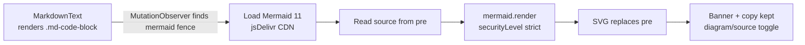

# dsh-mermaid-preview

<p align="center">
  
</p>

A Cordis client plugin that renders Markdown `mermaid` fenced code blocks as
diagrams inside the [DeepSeek Harness](https://github.com/deepseek-ai/deepseek-harness)
(dsh) web UI.

Chat, trajectory, plan review, compaction summaries — every surface rendered by
`MarkdownText` gets Mermaid support from one hook.

> 中文 README: [README.md](./README.md)

## Install

### Option 1: dsh native command (recommended)

```bash
dsh plugin --profile web add dsh-mermaid-preview
```

One command: pnpm install + auto-register as a web profile bundle layer +
restart `dsh web` to activate.

> If your dsh version does not support `dsh plugin`, upgrade first:
> `npm i -g @deepseek-ai/dsh`

### Option 2: Install from GitHub

```bash
dsh plugin --profile web add github:realguan/dsh-mermaid-preview
```

Build from source — great for contributing or tracking the latest main.

### Option 3: Local path install

```bash
git clone https://github.com/realguan/dsh-mermaid-preview.git
cd dsh-mermaid-preview && npm run build
dsh plugin --profile web add .
```

### Option 4: Dynamic plugin (no install, define in-session)

If you prefer not to modify the profile, ask your dsh agent to run
`cordis_define`, paste the contents of `dist/dsh-mermaid-preview.client.js`
as `code.client`, then run `cordis_run` and approve. See
[docs/install.md](./docs/install.md) for details.

### Uninstall

Edit `~/.dsh/profiles/web/package.json` and remove the `"dsh-mermaid-preview"`
line from `dependencies`, then:

```bash
cd ~/.dsh/profiles/web && pnpm install
```

Restart `dsh web` to take effect. Injected styles and observers are removed
with the profile layer; already-rendered SVGs persist as content and disappear
on page reload.

### Update

Re-run the install command (pnpm will fetch the latest version):

```bash
dsh plugin --profile web add dsh-mermaid-preview
```

## Features

- 🖼️ **No shell changes** — takes over `mermaid` fences via DOM observation;
  zero modification to dsh source
- ⚡ **One-command install** — `dsh plugin add` handles registration and deps
- 🌗 **Theme-aware** — follows the dsh light/dark theme and re-renders on switch
- 📋 **Keeps interactions** — the original copy button still works, plus a
  diagram/source toggle
- 🛟 **Graceful fallback** — keeps the code block with an inline note on CDN or
  syntax failure
- 🧹 **Clean uninstall** — styles, observer and listeners are removed on stop
- 🧪 **Standalone demo** — `demo/` is a dependency-free HTML page that works
  without dsh
- 📚 **Many diagram types** — flowchart / sequenceDiagram / classDiagram /
  stateDiagram-v2 / gantt / pie / erDiagram / journey / mindmap / gitGraph / timeline

## Try the standalone demo (no dsh needed)

```bash
npm run demo        # → http://localhost:8090
```

Edit Mermaid source on the left (10+ built-in presets), live render on the
right, theme selectable.

## Examples

[examples/showcase.md](./examples/showcase.md) — paste-ready sources for 11
diagram types; the same presets live in `demo/demo.js`.

## How it works (30 seconds)

dsh's Markdown renderer emits a stable `.md-code-block` structure for unknown
languages (including `mermaid`): a banner with the language label and a plain
`<pre><code>` body. The plugin observes `document.body` with a
`MutationObserver`, loads Mermaid 11 on demand via a `<script>` tag
(jsDelivr CDN), and replaces the `<pre>` with the rendered SVG — keeping the
banner and copy button intact.



Architecture, design trade-offs and known limits:
[docs/architecture.md](./docs/architecture.md).

## Layout

```
cordis.yml             dsh bundle composition (read by dsh plugin add)
src/client.js          the one plugin source (ES module)
scripts/build-dynamic.mjs    generates the dist paste payload
dist/                  dynamic plugin payload (ready to paste)
demo/                  dependency-free standalone demo
examples/showcase.md   diagram-type examples
docs/install.md        install / uninstall / update / FAQ
docs/architecture.md   internals and security notes
```

## Tech notes

| Item | Value |
| --- | --- |
| Platform | dsh web (client) |
| Plugin form | dsh bundle client plugin (`dsh plugin add`) |
| Mermaid | 11.16.1 (UMD, jsDelivr CDN, mirror-swappable) |
| Dependencies | none at runtime; scripts use Node built-ins only |
| Security | `securityLevel: 'strict'`; no data collection |
| License | MIT |

## FAQ

- **No render, CDN load error** — offline or jsDelivr unreachable. Change the
  `CDN` constant in `src/client.js`, `npm run build`, then update the plugin.
- **No render while streaming** — by design; rendering happens after settle.
- **No re-render on theme switch** — make sure your dsh version fires the
  `theme/change` event.

More in the FAQ section of [docs/install.md](./docs/install.md).

## Contributing

See [CONTRIBUTING.md](./CONTRIBUTING.md). After changing `src/client.js`, run
`npm run build` and commit the `dist/` artifact too.

## Acknowledgements

- [mermaid](https://github.com/mermaid-js/mermaid) — the diagram engine
- [DeepSeek Harness](https://github.com/deepseek-ai/deepseek-harness) — the platform
- [jsDelivr](https://www.jsdelivr.com/) — CDN distribution

## License

[MIT](./LICENSE) © 2026 realguan
