# dsh-mermaid-preview

<p align="center">
  
</p>

<p align="center">
  <a href="https://github.com/realguan/dsh-mermaid-preview/releases/latest"></a>
  <a href="./LICENSE"></a>
  <a href="https://github.com/deepseek-ai/deepseek-harness"></a>
  
  
</p>

<p align="center">
  Render Markdown <code>mermaid</code> fences as design-system diagram cards inside
  <a href="https://github.com/deepseek-ai/deepseek-harness">DeepSeek Harness</a>.
</p>

<p align="center">
  <a href="#install">Install</a> ·
  <a href="#screenshots">Screenshots</a> ·
  <a href="#features">Features</a> ·
  <a href="#troubleshooting">Troubleshooting</a>
</p>

> 中文: [README.md](./README.md)

---

## Install

**In one line**: paste the repository into dsh's plugin page, install, restart.

### 1. Desktop app (recommended)

1. Left rail → **Settings → Plugins** (or the **Plugins** page in the sidebar);
2. click **＋ Add plugin** in the top right;
3. enter:

   ```
   github:realguan/dsh-mermaid-preview
   ```

4. pick an **install source** if your network needs a mirror;
5. read the security notice → **Install**;
6. **restart the client**.

> ⚠️ Plugins run with your privileges. Only install sources you trust.
> There is no auto-update yet — uninstall before installing a newer version.

### 2. Command line

```bash
# the default profile
dsh plugin add github:realguan/dsh-mermaid-preview

# or name the profile explicitly (web / desktop)
dsh plugin --profile desktop add github:realguan/dsh-mermaid-preview
```

`dsh plugin add` **registers the package as a bundle layer automatically** — that
registration is what makes the plugin loadable, and it is not something you edit by
hand. Restart `dsh web` (or the desktop app) afterwards.

Pin a release:

```bash
dsh plugin --profile desktop add github:realguan/dsh-mermaid-preview#v0.6.0
```

### 3. From source (developers)

```bash
git clone https://github.com/realguan/dsh-mermaid-preview.git
cd dsh-mermaid-preview

npm run build          # src/ → dist/ (dist is committed; consumers never build)
npm run check          # syntax / manifest / artifact freshness / engine / no CDN

dsh plugin --profile web add link:$PWD
```

Re-run `npm run build` after editing `src/`; `npm run check` fails when `dist/` and
`src/` disagree.

### Verify it loaded

```bash
dsh --profile web --dump-config | grep -A2 mermaid-preview
```

Then send a message with a ` ```mermaid ` fence — you should get a diagram, not a
code block. Not working? See [Troubleshooting](#troubleshooting).

### Uninstall

```bash
dsh plugin --profile desktop remove dsh-mermaid-preview
```

`remove` reconciles too: the package name leaves `dsh.profile.bundles` on its own.
Every side effect (styles, observer, timers, injected DOM, viewer) is disposed with the
plugin fiber.

---

## Screenshots

### A diagram that lives in the conversation

Files and terminal on the left, the thread on the right — the diagram is a card in
that column. The type badge is colour-coded per diagram type; four controls sit on the
right (theme / copy source / show source / zoom).

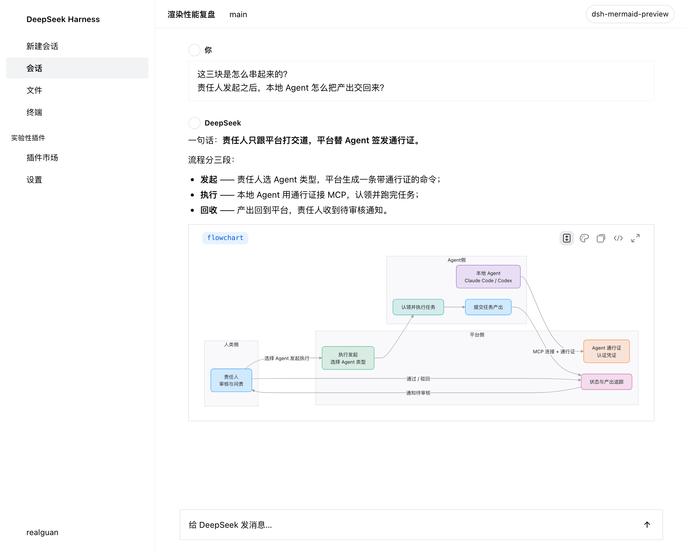

Same thread in the dark theme — palette, card and viewer all repaint together:

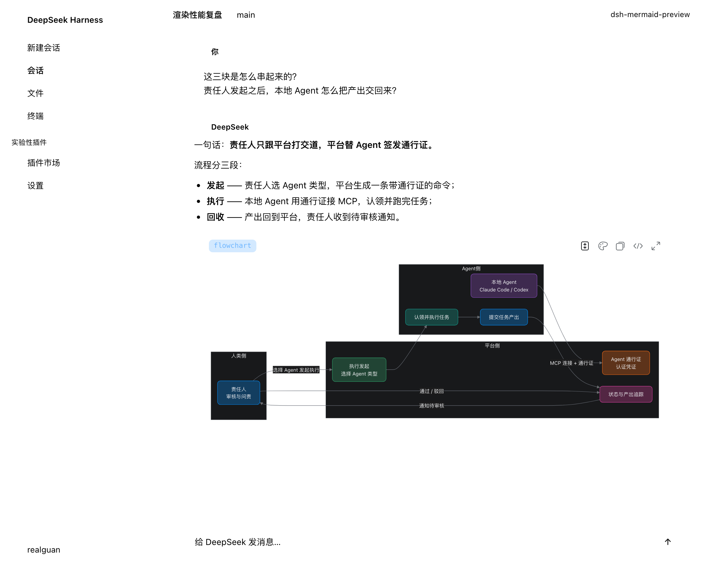

### 23 diagram types, one design language

This is not "the default mermaid palette in a new container" — node geometry, corner
radius and colour are re-derived per diagram type from the design system's own tokens.

| sequenceDiagram | timeline |
| --- | --- |
| 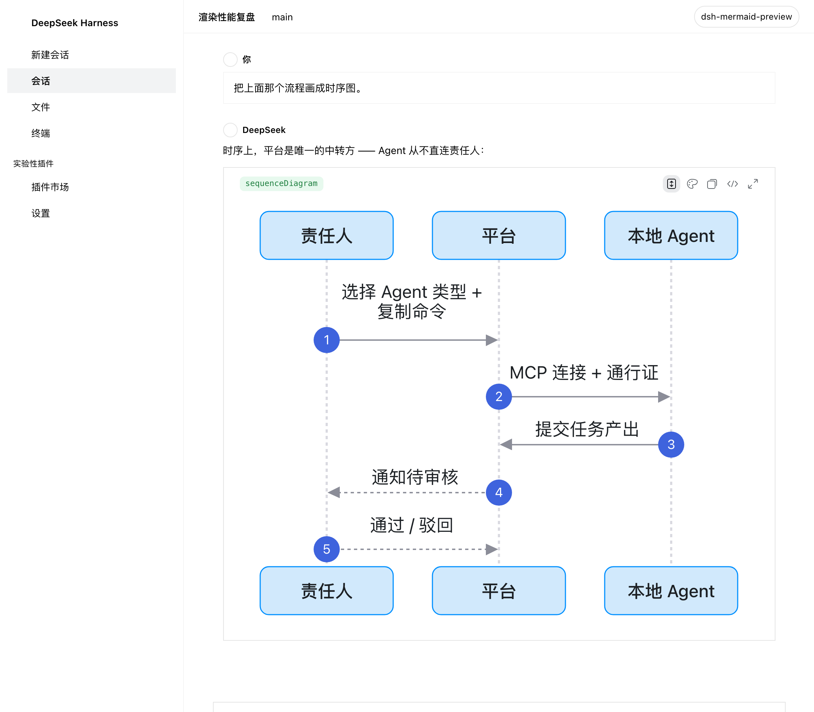 | 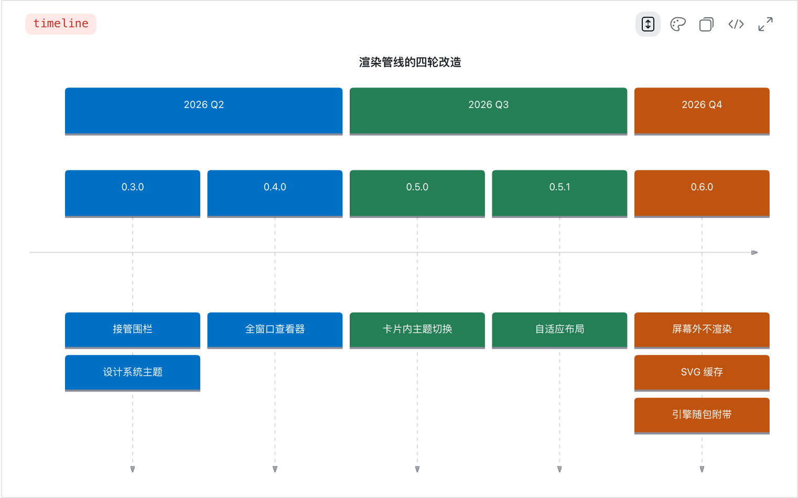 |

| gantt | mindmap |
| --- | --- |
| 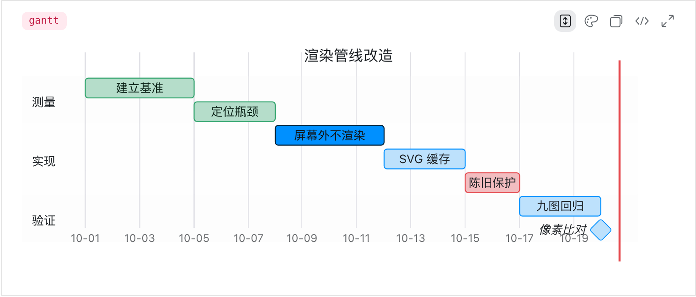 | 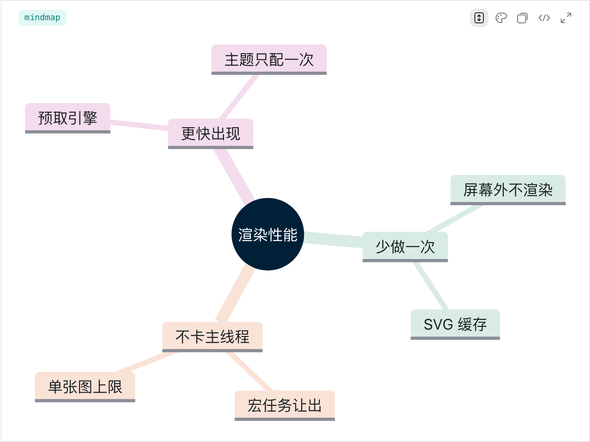 |

| journey | pie |
| --- | --- |
| 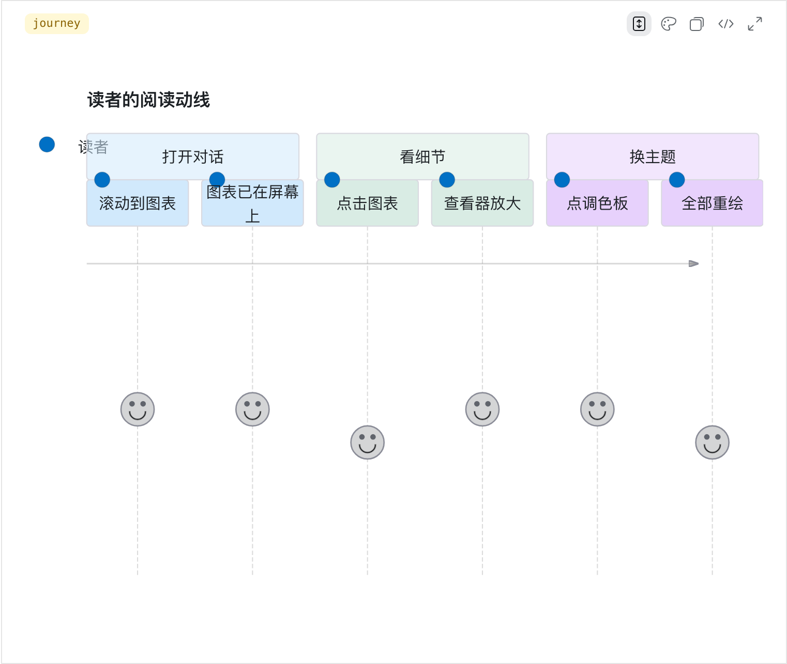 | 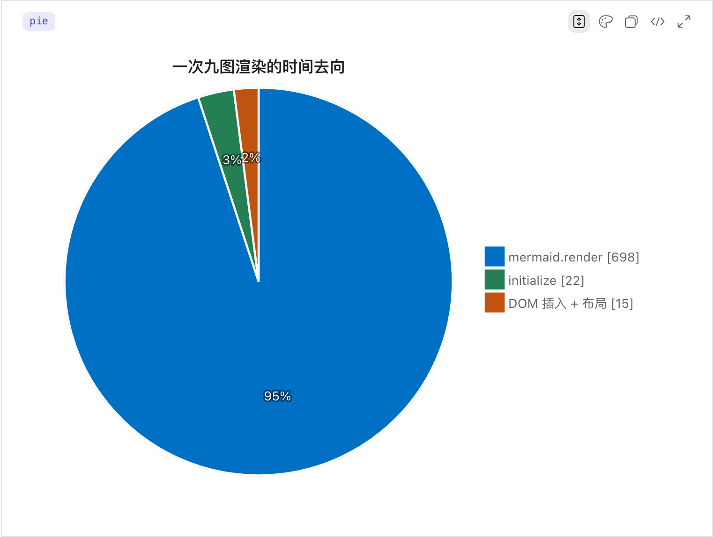 |

| classDiagram (dark) | a syntax error |
| --- | --- |
| 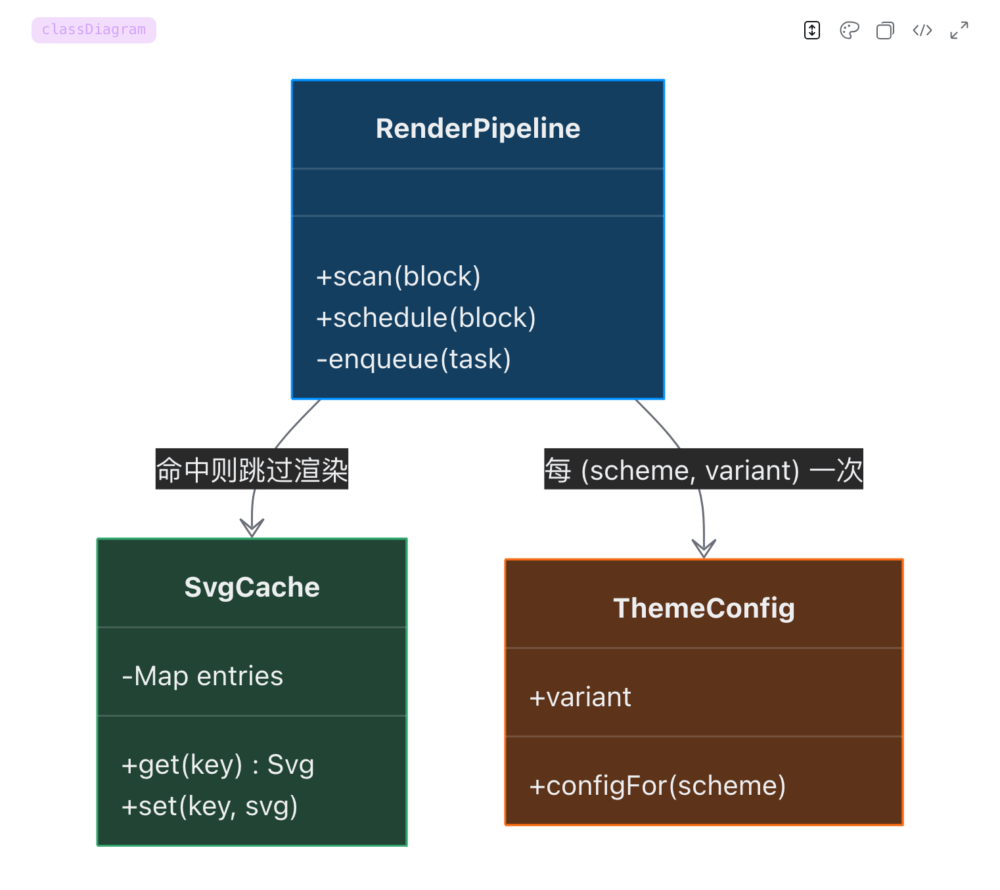 | 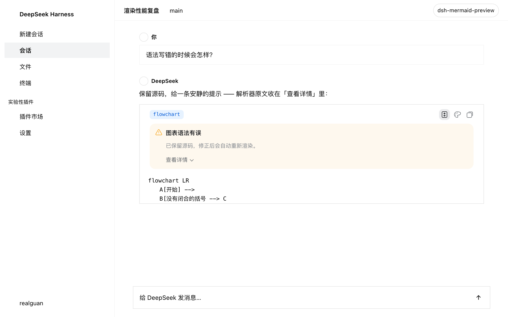 |

A failure is not a wall of red: the source is kept, a human sentence explains it, the
parser's own message sits behind "Details", and editing the fence retries.

### Try it without installing dsh

```bash
npm run demo        # → http://localhost:8090
```

Write Mermaid on the left, get a diagram on the right; the style dropdown compares
every theme live, and light/dark switches too. The demo `import`s the plugin's own
`src/theme.js`, so what you see is what the chat renders.

<p align="center">
  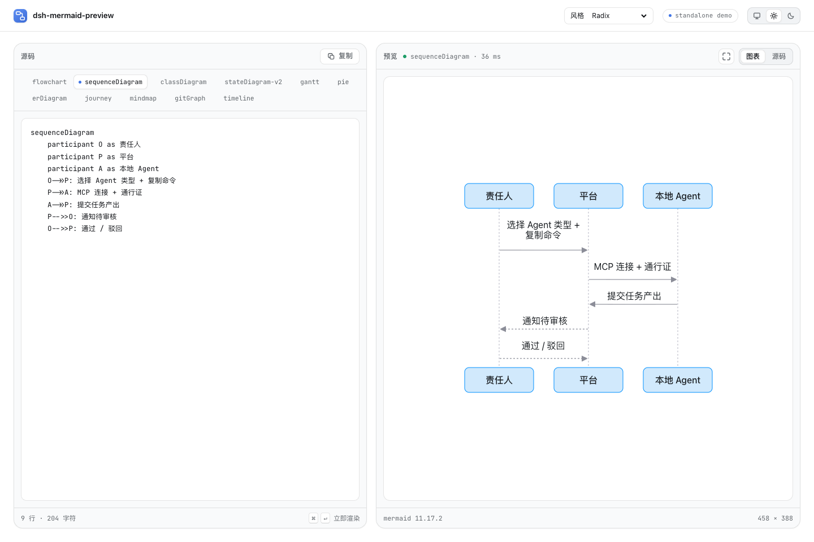
  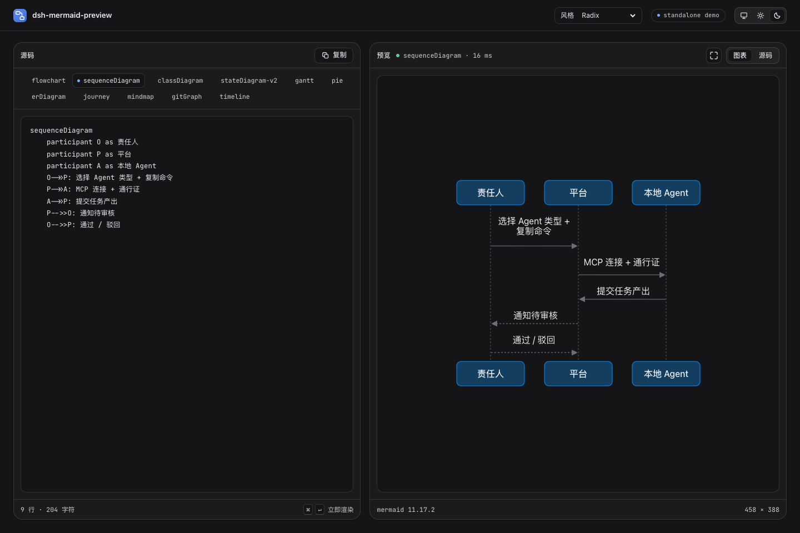
</p>

More diagram examples: [examples/showcase.md](./examples/showcase.md).

---

## Features

**🎨 Eight design-system themes, switchable from the card**
Default **Radix Colors**, plus Apple HIG, GitHub Primer, IBM Carbon, Atlassian,
Material Design 2, Shopify Polaris and a neutral dsh theme. Each one derives its
pastel nodes, data ramps and sequence/note/number colours from that system's real
tokens; corner radius follows the system's shape language. The palette button in the
card header opens the menu — every diagram repaints immediately and the choice is
remembered in `localStorage`.

**🌗 Follows light/dark and locale**
Palette, card and viewer repaint together on a theme switch; UI copy goes through
dsh's locale service, so it flips with the interface language.

**📐 The diagram fits the card**
Every diagram type fits the column width completely — wide diagrams scale down to show
the whole picture (no cropping, no horizontal scroll), small ones grow up to 1.5×. Card
layout toggles between **scroll container** (default: tall diagrams scroll inside the
card) and **fully expanded** (the card grows); the choice is remembered.

**🔍 Full-window viewer**
Click the diagram or the header's zoom control: blurred mask, floating toolbar, wheel
zoom anchored at the cursor, drag to pan, fit-to-window (small diagrams fill the
window, capped at 2.5×) / 1:1, double-click to toggle, `0` to reset, `Esc` to close.
That is where detail reading happens.

**🔌 Works offline, zero network requests**
The Mermaid engine **ships with the package** (`dist/client.mermaid.js`) and is served
on demand by dsh's own package-local chunk route. Diagrams render on an offline,
air-gapped or intranet-only machine — the plugin never touches the network.

**🧾 A diagram is not a code block**
The card header shows the diagram type (`flowchart` / `gantt` / `C4Container` …)
instead of "Code", and the shell's generic banner is hidden by attribute — no double
header.

**🛟 Fails softly**
A missing engine or a syntax error keeps the source and shows one calm note (a human
sentence plus expandable parser detail); editing the fence retries. Half-written fences
during streaming retry silently instead of flashing errors.

**⚡ Render less, not faster**
`mermaid.render` is 95% of a render, so the wins are all "do it once fewer times":
off-screen diagrams do not render until scrolled to, results are cached (LRU 40 /
4 MB), theme config is only pushed when `(scheme, variant)` changes, and the main
thread yields between render tasks. Measured on the nine-diagram corpus:
`mermaid.render` for off-screen diagrams 9 → 0; a second pass in the same palette
753 ms → 14 ms.

**📚 All 23 diagram types**
flowchart / sequenceDiagram / classDiagram / stateDiagram-v2 / gantt / pie / erDiagram /
journey / mindmap / gitGraph / timeline / quadrantChart / requirementDiagram / all C4
forms / sankey / block / packet / architecture / radar / treemap / kanban / xychart and
the other 11.x beta types.

**🧹 Clean disposal**
Styles, observers, timers, script tags, injected nodes, the viewer — all removed with
the plugin fiber.

---

## How it works (30 seconds)

dsh's Markdown renderer emits `.md-code-block`: a `[data-code-block-banner]` header and
a `[data-code-block-content]` body. For a language shiki does not know (including
`mermaid`) the header shows a generic label and the body is a plain `<pre>`.

The plugin uses a `MutationObserver` to find blocks whose body's first element is that
`<pre>`, checks whether the fence's first statement opens a Mermaid diagram, then loads
the engine on demand and injects the SVG into a holder appended **after** React's
children — hiding the original body with an attribute instead of replacing any
React-owned node.

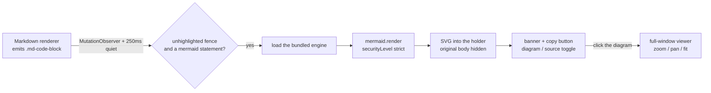

Full rationale, DOM contract, disposal strategy and known limits:
[docs/architecture.md](./docs/architecture.md). Diagram theme, card specs and visual
rules: [docs/design.md](./docs/design.md).

---

## Troubleshooting

### Installed, but nothing renders (the fence stays a code block)

Check these in order:

1. **Is the package name in the profile's bundle list?** —
   `dsh --profile <name> --dump-config | grep -A2 mermaid-preview`.
   `dsh plugin add` writes it; a hand-run `pnpm add` does **not**, and that is the most
   common cause.
2. **Any `client-modules:` errors in the console?** — they name the package and the
   broken declaration (missing `./client` export, module-graph cycle, …).
3. **Is the row in the page's boot manifest?** — run
   `window.__DSH_BOOT__.entries.map(e => e.id)`; it should contain
   `dsh-mermaid-preview`.
4. **Did you restart?** Replacing an installed package's code needs a restart — hot
   reload is not enough for a new bundle.

### "Mermaid engine not found"

`dist/client.mermaid.js` is missing, or the package was trimmed. The engine ships with
the plugin, so reinstall; `npm run check` verifies the file exists and is intact
(Mermaid 11.17.2).

### Nothing renders while streaming

By design. A fence must be quiet for 250 ms before it counts as finished; parse
failures mid-stream retry silently (400/900/1800 ms) and never flash a note.

### A broken diagram takes a moment to complain

Same reason: a half-written fence retries silently first. A genuinely broken diagram
shows its note about 3 seconds late.

### Too wide to read

Click the diagram (or the header's zoom control) for the full-window viewer. It uses a
copy of the SVG, so the code block is untouched.

### The colours are not what mermaid normally looks like

Since 0.5.0 diagrams are repainted onto `base` with each design system's palette (Radix
Colors by default) rather than mermaid's default palette. To change the default, edit
`THEME_VARIANT` at the top of `src/theme.js`
(`radix` / `apple` / `github` / `carbon` / `atlassian` / `material` / `polaris` /
`quiet`) and rebuild. A `%%{init: …}%%` directive inside the fence still wins.

### A non-mermaid fence turned into a diagram

Detection is content-based: a fence whose first line happens to be `graph TD` /
`flowchart LR` is claimed. Changing the language tag does not help (detection reads the
content); make the first line a non-mermaid statement.

### The UI is Chinese but the plugin copy is English

The plugin follows dsh's locale service. If it stays English, check
`document.documentElement.lang` (`zh*` on a Chinese UI) and whether
`@deepseek-ai/dsh-client-locale` is in the boot manifest. With neither, the plugin can
only fall back to its built-in English.

More: [docs/install.md](./docs/install.md).

---

## Compatibility

| Item | Value |
| --- | --- |
| DSH | `>=0.2.0-rc.2 <0.3.0`; exact per-release records below |
| Node | `>=18` |
| Mermaid | 11.17.2 (bundled with the package, no network) |
| Runtime dependencies | None (engine bundled; scripts use Node built-ins only) |
| Safety | `securityLevel: 'strict'`, `suppressErrorRendering`, no telemetry |

`compatible` DSH releases, each verified against **that release's own** published
client packages across five contract checks:

```
0.2.0-rc.1  0.2.0-rc.2  0.2.1-alpha.1 … 0.2.1-alpha.5  0.2.1-rc.1  0.2.1-rc.2
```

Criteria and per-release evidence: [docs/compatibility.md](./docs/compatibility.md).
Add a release:

```bash
npm run verify:compat -- 0.2.1-rc.2
```

> DSH STORE keeps a rolling window of the official latest three releases. When the
> window moves and the plugin has no matching declaration, the store listing is marked
> unlisted — so re-run the command above on every DSH release.

---

## Development

```bash
npm install            # dev tooling only; no runtime dependencies
npm run build          # src/ → dist/ (committed; consumers never build)
npm run check          # syntax / manifest / freshness / detection / engine / no CDN
npm run demo           # standalone demo page
npm run verify:compat  # per-DSH-release contract verification (needs network)
```

Render-cost benchmark (Playwright, real artifacts):

```bash
node bench/bench.mjs --reps 9 --label baseline
```

`bench/` is **not** a dependency of the package; install Playwright outside it. See
[bench/README.md](./bench/README.md) and [CONTRIBUTING.md](./CONTRIBUTING.md).

### Layout

```
index.js                            Host half (empty apply; gives the bundle a row)
cordis.patch.yml                    Bundle layer (dsh.bundle.patch)
src/client.js                       Plugin logic (ES module, export default)
src/theme.js                        Diagram theme (inlined at build time)
scripts/build.mjs                   src/ → dist/client.js + dynamic payload
scripts/vendor-engine.mjs           upstream mermaid.min.js → dist/client.mermaid.js
scripts/check.mjs                   verification entry point (npm run check)
scripts/verify-compat.mjs           per-DSH-release contract verification
scripts/serve-demo.mjs              standalone demo server
dist/client.js                      Native bundle (exports["./client"])
dist/client.mermaid.js              Bundled Mermaid engine (package-local chunk)
dist/dsh-mermaid-preview.client.js  Dynamic payload (paste-ready for cordis_define)
demo/                               Zero-dependency standalone demo
examples/showcase.md                Diagram gallery
docs/install.md                     Install / uninstall / update / verify / diagnose
docs/architecture.md                Implementation and safety notes
docs/design.md                      Diagram theme and visual rules
docs/compatibility.md               DSH compatibility claims and evidence
bench/                              Render-cost benchmark (not shipped)
```

---

## Credits

- [mermaid](https://github.com/mermaid-js/mermaid) — the diagram engine (MIT, bundled)
- [DeepSeek Harness](https://github.com/deepseek-ai/deepseek-harness) — the platform
- Design systems: Radix Colors, Apple HIG, GitHub Primer, IBM Carbon, Atlassian,
  Material 2, Polaris

## License

[MIT](./LICENSE) © 2026 realguan
