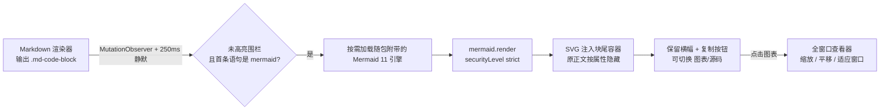

# dsh-mermaid-preview

<p align="center">
  
</p>

<p align="center">
  <a href="https://github.com/deepseek-ai/deepseek-harness"></a>
</p>

在 [DeepSeek Harness](https://github.com/deepseek-ai/deepseek-harness)（dsh）Web
界面中，把 Markdown 的 `mermaid` 围栏代码块渲染为图表的 Cordis 插件。

图表不是贴进对话里的 mermaid 默认图，而是用 **Radix Colors 等 7 套开源设计系统主题**
重绘、长在 dsh 里的原生卡片：按图型着色的类型标签 + 主题 / 复制 / 源码 / 放大，宽图横向
滚动，全窗口缩放查看器，失败时只留一条安静的提示。

对话、轨迹、计划评审、摘要 —— 所有走 `MarkdownText` 渲染的视图，一处接入，
处处生效。

> English README: [README.en.md](./README.en.md)

## 安装

> **⚠️ 0.3.0 起安装方式变了。** `dsh plugin --profile web add <pkg>` 只是 pnpm
> 透传，**只装依赖、不注册 bundle 层**。装了依赖却没把包名写进
> `dsh.profile.bundles`，插件就是死的——这是旧版本「装了没反应」的根因。
> 详见 [docs/install.md](./docs/install.md)。

### 方式一：让 Agent 安装（推荐）

在 dsh 会话里让模型调用 `plugin_manager`：

```
action: install_bundle
target: <包目录绝对路径>      # 或 github:realguan/dsh-mermaid-preview
```

安装 + 注册 bundle + HMR 生效一步完成。

### 方式二：手动

```bash
dsh plugin --profile web add github:realguan/dsh-mermaid-preview
```

然后**必须**把包注册成 bundle 层——编辑 `~/.dsh/profiles/web/package.json`，
在 `dsh.profile.bundles` 里追加 `"dsh-mermaid-preview"`，再 `pnpm install`；
或在 profile 的用户 patch 层 `~/.dsh/profiles/web/cordis.patch.yml` 里：

```yaml
- insert:
    - id: mermaid-preview
      name: dsh-mermaid-preview
```

### 方式三：动态插件（免安装，会话内定义）

把 `dist/dsh-mermaid-preview.client.js` 的内容作为 `code.client` 交给
`cordis_define`，再 `cordis_run` 并允许。详见 [docs/install.md](./docs/install.md)。

### 验证安装

```bash
dsh --profile web --dump-config | grep -A2 mermaid-preview
```

再用一条带 ```mermaid 围栏的消息确认出图。完整清单见
[docs/install.md](./docs/install.md) § 验证。

## 特性

- 🖼️ **免改壳层**：不修改 dsh 任何源码，通过 DOM 观察自动接管 mermaid 围栏
- 🧭 **识别跟随当前渲染契约**：以「未高亮围栏 + 首条 mermaid 语句」判定，
  不依赖会消失的语言标签（见 [architecture.md](./docs/architecture.md) §2）
- 🌈 **可切换的设计系统主题**：默认 **Radix Colors**（作者的最终选择），内置 7 套风格——
  **Radix Colors、Apple HIG、GitHub Primer、IBM Carbon、Atlassian Design System、
  Material Design 2、Shopify Polaris**，另有原来的 dsh 中性主题。每套都从设计系统官方的实色/中性色 token
  重新推导粉彩节点、数据图 ramp、序列图/便签/序号配色；节点圆角也跟随该系统的形状语言
  （Carbon/Material 更方，Radix/Apple 更圆）
- 🎨 **在卡片里直接换主题**：每张图表卡片头部的调色板按钮打开主题菜单，8 套风格各带
  三色 swatch、当前项打勾；选择后页面上所有图表即时重绘，并记住你的选择（localStorage）。
  想改默认值就改 `src/theme.js` 的 `THEME_VARIANT`（见
  [design.md](./docs/design.md)）；演示页顶部的「风格」下拉框也可实时对比全部风格
- 🌗 **跟随主题**：明/暗主题实时重绘；切主题时图表配色、卡片和查看器一起切换
- 🌐 **跟随语言**：文案走 Client locale 服务，中英随界面切换
- 📋 **一张卡片一个头部**：不替换 React 节点；自绘头部左侧是按图表类型配色的彩色标签
  （Apple 系统色 tint + 同色文字），右侧是「主题 / 复制源码 / 显示源码 / 放大」四个控件，
  源码视图就是 React 原来那个 `<pre>`。壳层通用的「代码块」横幅用属性隐藏，不再出现
  两行头部
- 🧾 **图表不是代码**：卡片头部左侧显示图表类型（`flowchart` / `sequenceDiagram` /
  `gantt` …），而不是无意义的「代码块」标签
- 📐 **图会跟着卡片走**：所有图型都按卡片宽度**完整适配**——宽图等比缩小到整图
  可见（不裁切、不横向滚动），小图最多放大到 1.5×（图示比正文略大、不喧宾夺主）。
  卡片布局可切换：头部新增布局按钮，默认**滚动容器**（高图限高、卡片内滚动），
  点一下变成**完整展开**（卡片随图变高，滚轮直接滚文档），选择会记住。点击图表或
  头部放大按钮进入全窗口查看器：模糊遮罩、悬浮工具条、滚轮缩放、拖拽平移、
  **适应窗口（小图会放大到填满窗口，上限 2.5×）** / 1:1、`Esc` 关闭（见
  [architecture.md](./docs/architecture.md) §7）
- 🛟 **失败兜底不吓人**：引擎缺失或语法错误时保留源码，给一条安静的提示
  （一句人话 + 可展开的解析器详情），不再是整屏红字；文本一改就自动重试
- 🧹 **干净卸载**：样式、观察器、定时器、脚本、注入节点全部随插件 fiber 清理
- 🧪 **可自检**：`npm run check` 校验语法、manifest、产物一致性、识别用例与版本一致
- 📚 **全部 23 种图型都吃主题**：flowchart / sequenceDiagram / classDiagram /
  stateDiagram-v2 / gantt / pie / erDiagram / journey / mindmap / gitGraph /
  timeline / quadrantChart / requirementDiagram / 各类 C4 / sankey / block /
  packet / architecture / radar / treemap / kanban / xychart 等（含 11.x beta 图型）

## 本地体验独立演示页（无需 dsh）

```bash
npm run demo        # → http://localhost:8090
```

左侧编辑 Mermaid 源码（内置 11+ 种图型预设），右侧实时渲染；顶部「风格」下拉框
可实时切换 Radix / Apple / GitHub / Carbon / Atlassian / Material / Polaris / 中性主题，
主题可切换明暗。
演示页直接 `import` 插件的 `src/theme.js`，所以它看到的图表和 dsh 对话里完全一致。

| 浅色 | 深色 |
| --- | --- |
|  |  |

## 图型示例

见 [examples/showcase.md](./examples/showcase.md)。

## 工作原理（30 秒版）

dsh 的 Markdown 渲染器把围栏渲染成 `.md-code-block`：头部是
`[data-code-block-banner]`，正文是 `[data-code-block-content]`。对 shiki 不认识的
语言（含 `mermaid`），头部只显示通用「代码」文案，正文是纯 `<pre>`。

插件用 `MutationObserver` 找到「正文首元素是 `<pre>`」的块，再看围栏首条语句是不是
mermaid 语句；命中后按需加载 Mermaid 11 引擎，把渲染好的 SVG 放进
追加在块尾部的 `.dsh-mermaid` 容器，并用一个属性隐藏原正文——**从不替换或删除
React 拥有的节点**。

引擎**随包附带**（`dist/client.mermaid.js`，约 3.4MB），由 dsh 自己的分包路由
按需送达：插件**不联网**，断网、内网、隔离网环境都能出图。



完整原理、DOM 契约、清理策略与已知边界见 [docs/architecture.md](./docs/architecture.md)；
图表主题、卡片规格与视觉规则见 [docs/design.md](./docs/design.md)。

## 目录结构

```
index.js                        Host 半侧（空 apply，仅为可挂载的 bundle 行）
cordis.patch.yml                bundle 层（dsh.bundle.patch 指向它）
src/client.js                   插件逻辑源码（ES module，export default）
src/theme.js                    图表主题（明/暗 themeVariables + 布局配置；构建时内联进产物）
scripts/build.mjs               生成 dist/client.js 与 dist/dsh-mermaid-preview.client.js
scripts/check.mjs               自检：语法 / manifest / 产物一致性 / 识别用例 / 版本一致
dist/client.js                  原生 bundle（exports["./client"]，client-modules 加载）
dist/dsh-mermaid-preview.client.js  动态插件载荷（cordis_define 粘贴用）
locale/{en,zh}.json             插件展示标题与描述
icon.svg                        插件图标
demo/                           零依赖独立演示页
examples/showcase.md            图型示例合集
docs/install.md                 安装 / 卸载 / 更新 / 验证 / FAQ
docs/architecture.md            实现原理与安全说明
docs/compatibility.md           DSH 版本兼容性声明与逐版本证据
```

## 技术要点

| 项 | 值 |
| --- | --- |
| 平台 | dsh Web（Client 半侧）+ 空 Host 半侧 |
| 插件形态 | dsh bundle 客户端插件（`dsh.bundle.patch` + `dsh.client`） |
| DSH 兼容 | 逐版本声明在 `dsh.compatibility.dshReleases`，依据见 [docs/compatibility.md](./docs/compatibility.md) |
| Mermaid | 11.17.2（随包附带的引擎，`dist/client.mermaid.js`，不联网） |
| 依赖 | 无运行时依赖（引擎随包附带）；工具脚本仅用 Node 内置模块 |
| 安全 | `securityLevel: 'strict'`；`suppressErrorRendering`；不采集任何数据 |
| 许可证 | MIT |

## 常见问题

- **装上了完全不渲染**：先确认包名在 `dsh.profile.bundles` 里，并且
  `dsh --profile web --dump-config` 能看到 `mermaid-preview` 行。只装依赖不注册
  bundle 是最常见的原因。
- **控制台报 `client-modules:` 开头的错**：错误信息会指出是哪个包的哪个声明有问题
  （缺 `./client` 导出、模块图成环等）。
- **报「图表引擎未找到」**：包里的引擎文件 `dist/client.mermaid.js` 缺失或没装上。
  引擎随包一起安装，重新安装插件即可（`npm run check` 会检查这个文件）。
- **流式过程中不渲染**：设计如此，围栏静默 250ms 后才渲染；流式中途的解析失败会静默
  退避重试，不会弹错误，围栏写完后自动渲染。
- **语法错误的图等一会儿才报错**：设计如此。停顿超过静默窗口的半截围栏先静默重试
  （约 3 秒），确认文本不再变化仍失败才显示提示条——一句「图表语法有误」，解析器原始
  信息收在「查看详情」里；之后围栏内容一变，提示立即消失并重新渲染。
- **非 mermaid 围栏被渲染成图**：识别是内容驱动的，首行恰好是 `graph TD` 之类语句
  的围栏会被接管；把首行改成非 mermaid 语句即可。
- **图太宽，字看不清**：卡片会把整图缩放到卡片宽度完整显示（不裁切）；图缩得较小时
  点图表或卡片头部的放大按钮，进入全窗口查看器。默认适应窗口，滚轮缩放（以光标为
  锚点）、按住拖拽平移，双击在适应窗口与 1:1 之间切换，`0` 复位，`Esc` 关闭。查看器
  是 SVG 的副本，原代码块不受影响。
- **图表颜色和我之前看到的不一样了**：0.5.0 起默认使用 Radix Colors 图表主题，不再使用
  mermaid 默认调色板；旧的薰衣草紫节点不会再有。点任意图表卡片头部的调色板按钮换风格，
  选择会立刻应用并记住；想把默认值换掉则改 `src/theme.js` 顶部的 `THEME_VARIANT`
  （`radix` / `apple` / `github` / `carbon` / `atlassian` / `material` / `polaris` /
  `quiet`）后 `npm run build`。围栏里的 `%%{init: …}%%` 指令仍可覆盖主题。
- **界面是中文，插件却是英文**：正常情况下会跟随 dsh 的语言设置（locale 服务就绪后
  绑定命名空间字典，未就绪时按 `<html lang>` 选内置字典）。若仍是英文，说明 dsh
  既没提供 locale 服务也没设置文档语言，可把 `DICT` 里的键补进自己的语言或提 issue。

更多见 [docs/install.md](./docs/install.md)。

## 贡献

见 [CONTRIBUTING.md](./CONTRIBUTING.md)。改 `src/client.js` 后请
`npm run build` 并同步提交 `dist/`（`npm run check` 会拦住忘记 build 的情况）。

## 致谢

- [mermaid](https://github.com/mermaid-js/mermaid) —— 图表引擎（MIT，随包附带）
- [DeepSeek Harness](https://github.com/deepseek-ai/deepseek-harness) —— dsh 平台

## License

[MIT](./LICENSE) © 2026 realguan
