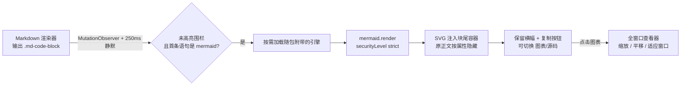

# dsh-mermaid-preview

<p align="center">
  
</p>

<p align="center">
  <a href="https://github.com/realguan/dsh-mermaid-preview/releases/latest"></a>
  <a href="./LICENSE"></a>
  <a href="https://github.com/deepseek-ai/deepseek-harness"></a>
  
  
</p>

<p align="center">
  在 <a href="https://github.com/deepseek-ai/deepseek-harness">DeepSeek Harness</a> 里，把 Markdown 的
  <code>mermaid</code> 围栏渲染成设计系统配色的原生图表卡片。
</p>

<p align="center">
  <a href="#安装">安装</a> ·
  <a href="#看效果">看效果</a> ·
  <a href="#特性">特性</a> ·
  <a href="#常见问题">常见问题</a>
</p>

> English: [README.en.md](./README.en.md)

---

## 安装

**一句话**：把仓库地址贴进 dsh 的插件页，装完重启。

### 方式一：桌面客户端图形界面（推荐）

1. 左侧导航 → **设置 → 插件**（或侧栏的**插件**页）；
2. 点右上角 **＋ 添加插件**；
3. 输入框里填：

   ```
   github:realguan/dsh-mermaid-preview
   ```

4. 选**安装源**（国内网络可选「中国大陆镜像源」）；
5. 读完安全提示 → **安装**；
6. **重启客户端**（替换已装包的同名代码需要重启，热更新不足以让新 bundle 生效）。

> ⚠️ 插件在本机以你的权限运行。只装来源可信的插件。
> 插件安装后暂不支持自动更新 —— 升级要先卸载再装新版。

### 方式二：命令行

```bash
# 装进默认 profile
dsh plugin add github:realguan/dsh-mermaid-preview

# 或明确指定 profile（web / desktop）
dsh plugin --profile desktop add github:realguan/dsh-mermaid-preview
```

**`dsh plugin add` 会自动把包注册成 bundle 层** —— 这正是本插件能被加载的关键，
不需要再手改配置。装完重启 `dsh web`（或重启桌面客户端）即生效。

想固定到某个版本：

```bash
dsh plugin --profile desktop add github:realguan/dsh-mermaid-preview#v0.6.0
```

### 方式三：本地源码（开发者）

```bash
git clone https://github.com/realguan/dsh-mermaid-preview.git
cd dsh-mermaid-preview

npm run build          # 从 src/ 重建 dist/（dist 已随仓库提交，消费者无需构建）
npm run check          # 自检：语法 / manifest / 产物一致性 / 引擎完整性 / 无 CDN

dsh plugin --profile web add link:$PWD
```

改完 `src/` 之后要重新 `npm run build`；`dist/` 与 `src/` 不一致时 `npm run check` 会直接失败。

### 验证装好了

```bash
# 组合结果里应该有 mermaid-preview 行
dsh --profile web --dump-config | grep -A2 mermaid-preview
```

然后在任意会话里发一条带 ` ```mermaid ` 围栏的消息 —— 应该出图，不是代码块。

**没反应？** 见 [常见问题](#装上了但完全不渲染围栏还是代码块)。

### 卸载

```bash
dsh plugin --profile desktop remove dsh-mermaid-preview
```

或在插件页里关掉。卸载后卡片 DOM、样式、注入节点全部随插件 fiber 清理。

---

## 看效果

### 一张图，长在对话里

左侧是文件树、终端并排的工作区，右边是会话列——图表就是这个宽度里的一张卡片：
类型标签按图型配色，右侧四个控件（主题 / 复制源码 / 显示源码 / 放大）。


同一段对话切到深色主题，配色、卡片、查看器一起重绘：


### 23 种图型，一套设计语言

不是「mermaid 默认调色板换个容器」——每种图型的节点形状、圆角、配色都按设计系统的
语言重新推导。下面几个是同一套主题下的不同图型（点开可看原始尺寸）：

| sequenceDiagram | timeline |
| --- | --- |
|  |  |

| gantt | mindmap |
| --- | --- |
|  |  |

| journey | pie |
| --- | --- |
|  |  |

| classDiagram（深色） | 语法错误时 |
| --- | --- |
|  |  |

失败不是红色报错墙：保留源码，给一句人话，解析器原文收在「查看详情」里，
文本一改就自动重试。

### 想先试试？不用装 dsh

```bash
npm run demo        # → http://localhost:8090
```

左边写 Mermaid，右边实时出图；顶部「风格」下拉框可实时对比全部主题，明暗也能切。
演示页直接 `import` 插件的 `src/theme.js`，所以它看到的图和对话里完全一致。

<p align="center">
  
  
</p>

更多图型示例见 [examples/showcase.md](./examples/showcase.md)。

---

## 特性

**🎨 8 套设计系统主题，卡片里直接换**
默认 **Radix Colors**，另有 Apple HIG、GitHub Primer、IBM Carbon、Atlassian、
Material Design 2、Shopify Polaris，以及一套中性的 dsh 主题。每套都从该系统官方的
实色/中性色 token 重新推导粉彩节点、数据图 ramp、序列图与便签配色；节点圆角跟随该
系统的形状语言（Carbon/Material 更方，Radix/Apple 更圆）。点卡片头部的调色板按钮就能
换，页面上所有图表即时重绘，选择记在 localStorage 里。

**🌗 跟随明暗与语言**
切主题时图表配色、卡片和查看器一起重绘；按钮和提示走 dsh 的 locale 服务，中英随界面切换。

**📐 图跟着卡片走**
所有图型按卡片宽度**完整适配** —— 宽图等比缩小到整图可见（不裁切、不横向滚动），
小图最多放大 1.5×。卡片布局可切换：默认**滚动容器**（高图限高、卡片内滚动），
点一下变**完整展开**（卡片随图变高），选择会记住。

**🔍 全窗口查看器**
点图表或头部放大按钮进入：模糊遮罩、悬浮工具条、滚轮缩放（以光标为锚点）、
拖拽平移、适应窗口（小图会放大到填窗，上限 2.5×）/ 1:1、双击切换、`0` 复位、
`Esc` 关闭。看细节靠它，不靠把卡片撑大。

**🔌 离线可用，零网络请求**
Mermaid 引擎**随包附带**（`dist/client.mermaid.js`），由 dsh 自己的包内分块路由按需
送达。断网、内网、隔离网都能出图 —— 插件全程不联网。

**🧾 图表不是代码**
卡片头部左侧显示图表类型（`flowchart` / `gantt` / `C4Container` …）而不是「代码块」，
壳层那条通用横幅被属性隐藏，不会出现两行头。

**🛟 失败不吓人**
引擎缺失或语法错误时保留源码，给一条安静的提示条（一句人话 + 可展开的解析器详情），
文本一改就自动重试。流式输出中途的半截围栏静默退避重试，不弹错误。

**⚡ 少渲染，而不是渲染得更快**
`mermaid.render` 本身占一次渲染 95% 的开销，所以优化都在「少做一次」：屏幕外的图不渲染
（滚到再渲染）、渲染结果缓存（LRU 40 条 / 4MB）、主题配置只在 `(scheme, variant)` 变化
时下发、每个渲染任务之间让出主线程。实测九图语料：屏幕外 `mermaid.render` 9 次 → 0 次，
同配色再来一轮 753ms → 14ms。

**📚 23 种图型全覆盖**
flowchart / sequenceDiagram / classDiagram / stateDiagram-v2 / gantt / pie / erDiagram /
journey / mindmap / gitGraph / timeline / quadrantChart / requirementDiagram / 各类 C4 /
sankey / block / packet / architecture / radar / treemap / kanban / xychart 等。

**🧹 干净卸载**
样式、观察器、定时器、脚本、注入节点、查看器全部随插件 fiber 清理。

---

## 工作原理（30 秒版）

dsh 的 Markdown 渲染器把围栏渲染成 `.md-code-block`：头部是
`[data-code-block-banner]`，正文是 `[data-code-block-content]`。对 shiki 不认识的
语言（含 `mermaid`），头部只显示通用文案，正文是纯 `<pre>`。

插件用 `MutationObserver` 找到「正文首元素是 `<pre>`」的块，再判围栏首条语句是不是
mermaid 语句；命中后按需加载引擎，把 SVG 注入追加在块尾部的容器，并用一个属性隐藏原
正文 —— **从不替换或删除 React 拥有的节点**。



完整原理、DOM 契约、清理策略与已知边界见 [docs/architecture.md](./docs/architecture.md)；
图表主题、卡片规格与视觉规则见 [docs/design.md](./docs/design.md)。

---

## 常见问题

### 装上了但完全不渲染（围栏还是代码块）

按顺序查三件事：

1. **包名在 profile 的 bundle 列表里吗** —— `dsh --profile <名字> --dump-config | grep -A2 mermaid-preview`。
   `dsh plugin add` 会自动写入；手工 `pnpm add` **不会**，这是最常见的失败原因。
2. **控制台有 `client-modules:` 开头的报错吗** —— 它会明确说出是哪个包的哪个声明有问题
   （缺 `./client` 导出、模块图成环等）。
3. **页面 boot 清单里有这一行吗** —— 控制台执行
   `window.__DSH_BOOT__.entries.map(e => e.id)`，应包含 `dsh-mermaid-preview`。

前两条都过了还是不出图，就是**没重启**。替换已装包的同名代码需要重启，不是热更新。

### 报「图表引擎未找到」

包里的 `dist/client.mermaid.js` 没装上，或装的是被裁剪过的包。引擎随包安装，
重新安装一次即可；本地可用 `npm run check` 验证该文件存在且完整（当前是 Mermaid 11.17.2）。

### 流式输出时不渲染

设计如此。围栏要静默 250ms 才认为写完；中途的解析失败会静默退避重试（400/900/1800ms），
不弹错误，围栏写完自动渲染。

### 语法错误的图等一会儿才报错

同上 —— 停顿超过静默窗口的半截围栏先静默重试，确认文本不再变化仍失败才显示提示条。
真正写错的图，提示会晚约 3 秒出现。

### 图太宽，字看不清

点图表本身或卡片头部的放大按钮，进全窗口查看器。查看器用的是 SVG 副本，
关闭后代码块不受影响。

### 图表配色和我以前看到的不一样

0.5.0 起用各设计系统的色板重绘 `base` 主题（默认 Radix Colors），不再用 mermaid 默认
调色板。想换默认值就改 `src/theme.js` 顶部的 `THEME_VARIANT`
（`radix` / `apple` / `github` / `carbon` / `atlassian` / `material` / `polaris` / `quiet`），
然后 `npm run build`。围栏里的 `%%{init: …}%%` 指令仍然可以覆盖主题。

### 某个 `text` 围栏被渲染成了图

识别是内容驱动的：首行恰好是 `graph TD` / `flowchart LR` 之类语句的围栏会被接管。
换语言标签（`text` → `plaintext`）没用，因为判定看内容；把首行改成非 mermaid 语句即可。

### 界面是中文，插件文案却是英文

插件跟随 dsh 的语言设置。若仍显示英文，检查
`document.documentElement.lang` 是否为 `zh*`，以及 boot 清单里有没有
`@deepseek-ai/dsh-client-locale`。两者都不成立时插件只能退回内置英文。

更多排查见 [docs/install.md](./docs/install.md)。

---

## 兼容性

| 项 | 值 |
| --- | --- |
| DSH | `>=0.2.0-rc.2 <0.3.0`；逐版本精确记录见下 |
| Node | `>=18` |
| Mermaid | 11.17.2（随包附带，不联网） |
| 运行时依赖 | 无（引擎随包；工具脚本只用 Node 内置模块） |
| 安全 | `securityLevel: 'strict'`、`suppressErrorRendering`、不采集任何数据 |

已验证 `compatible` 的 DSH 版本（每一条都用**该版本自己**发布的客户端包跑过五项契约检查）：

```
0.2.0-rc.1  0.2.0-rc.2  0.2.1-alpha.1 … 0.2.1-alpha.5  0.2.1-rc.1  0.2.1-rc.2
```

判定标准与逐版本证据见 [docs/compatibility.md](./docs/compatibility.md)；新增一个版本：

```bash
npm run verify:compat -- 0.2.1-rc.2
```

> DSH STORE 以「官方最新三个发行版」为兼容窗口。窗口滚动后如果本插件没跟进声明，
> 商城条目会被判「兼容性暂时下架」—— 所以每次 DSH 发版都要重跑上面这条命令。

---

## 开发

```bash
npm install            # 只有 Playwright 之类的开发工具，无运行时依赖
npm run build          # src/ → dist/（产物随仓库提交，消费者不构建）
npm run check          # 语法 / manifest / 产物同步 / 识别用例 / 引擎完整性 / 无 CDN
npm run demo           # 独立演示页
npm run verify:compat  # 按 DSH 版本逐个验证兼容契约（需要网络）
```

渲染性能基准（Playwright，量真实产物）：

```bash
node bench/bench.mjs --reps 9 --label baseline
```

`bench/` **不是**运行时依赖，Playwright 要单独装在包外。细节见
[bench/README.md](./bench/README.md) 与 [CONTRIBUTING.md](./CONTRIBUTING.md)。

### 目录结构

```
index.js                            Host 半侧（空 apply，仅为可挂载的 bundle 行）
cordis.patch.yml                    bundle 层（dsh.bundle.patch 指向它）
src/client.js                       插件逻辑源码（ES module，export default）
src/theme.js                        图表主题（构建时内联进产物）
scripts/build.mjs                   src/ → dist/client.js + 动态载荷
scripts/vendor-engine.mjs           上游 mermaid.min.js → dist/client.mermaid.js
scripts/check.mjs                   自检入口（npm run check）
scripts/verify-compat.mjs           按 DSH 版本验证兼容契约
scripts/serve-demo.mjs              独立演示页服务器
dist/client.js                      原生 bundle（exports["./client"]）
dist/client.mermaid.js              随包附带的 Mermaid 引擎（包内分块）
dist/dsh-mermaid-preview.client.js  动态插件载荷（cordis_define 粘贴用）
demo/                               零依赖独立演示页
examples/showcase.md                图型示例合集
docs/install.md                     安装 / 卸载 / 更新 / 验证 / 排查
docs/architecture.md                实现原理与安全说明
docs/design.md                      图表主题与视觉规则
docs/compatibility.md               DSH 兼容性声明与逐版本证据
bench/                              渲染成本基准（不带进包）
```

---

## 致谢

- [mermaid](https://github.com/mermaid-js/mermaid) —— 图表引擎（MIT，随包附带）
- [DeepSeek Harness](https://github.com/deepseek-ai/deepseek-harness) —— 平台
- 各设计系统：Radix Colors、Apple HIG、GitHub Primer、IBM Carbon、Atlassian、Material 2、Polaris

## License

[MIT](./LICENSE) © 2026 realguan
