# 图型示例合集

以下 10 种 Mermaid 图型可直接粘贴进 dsh 会话（插件会自动渲染），
或粘贴进 `demo/` 独立演示页体验。与 `demo/demo.js` 中的预设一一对应。

## 1. 流程图 flowchart

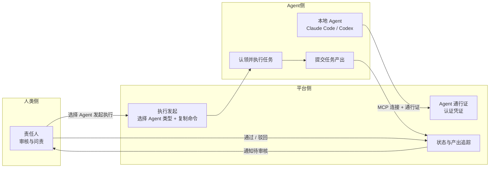

## 2. 时序图 sequenceDiagram

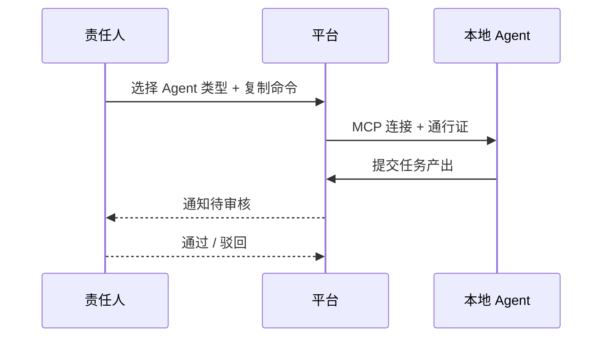

## 3. 类图 classDiagram

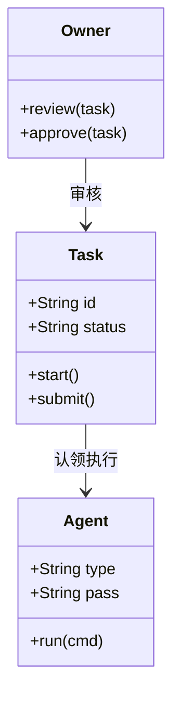

## 4. 状态图 stateDiagram-v2

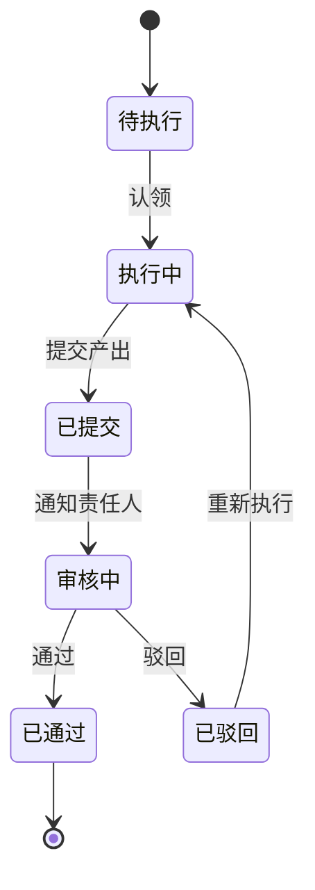

## 5. 甘特图 gantt

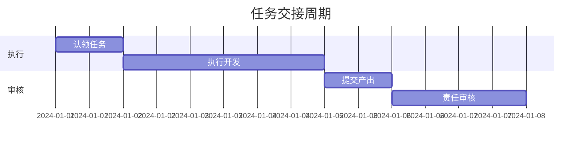

## 6. 饼图 pie

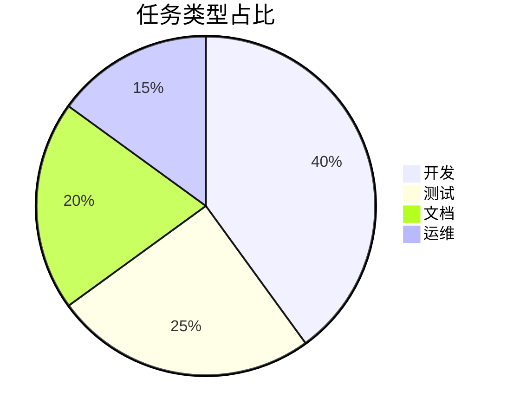

## 7. ER 图 erDiagram

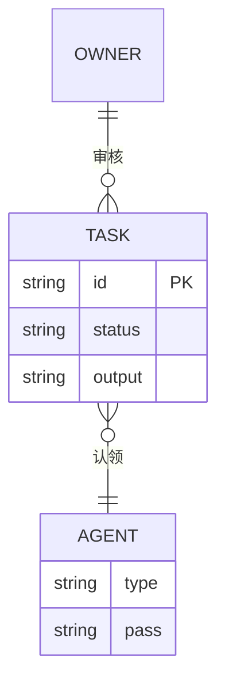

## 8. 旅程图 journey

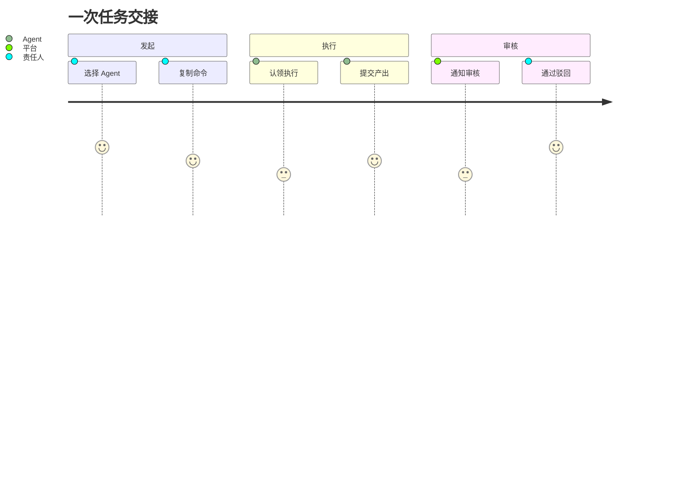

## 9. 思维导图 mindmap

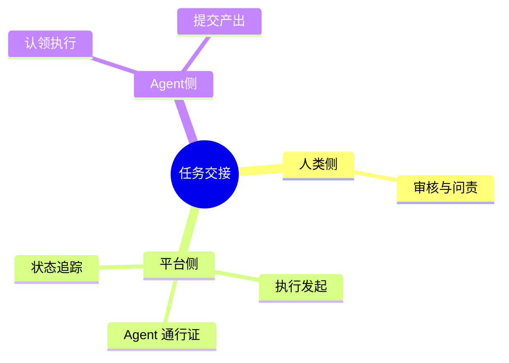

## 10. Git 图 gitGraph

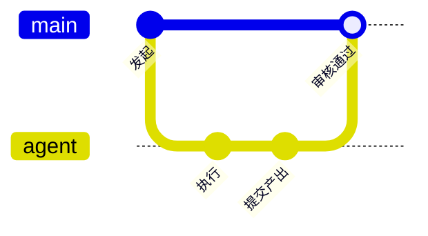

## 11. 时间线 timeline

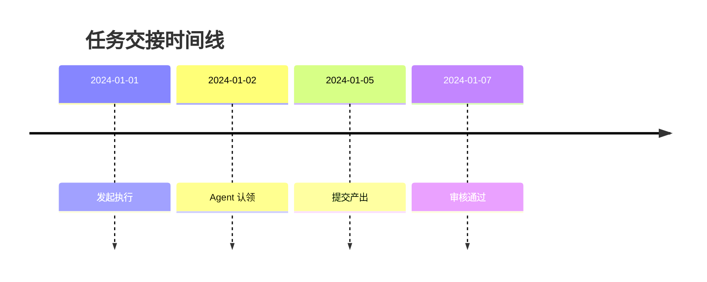
